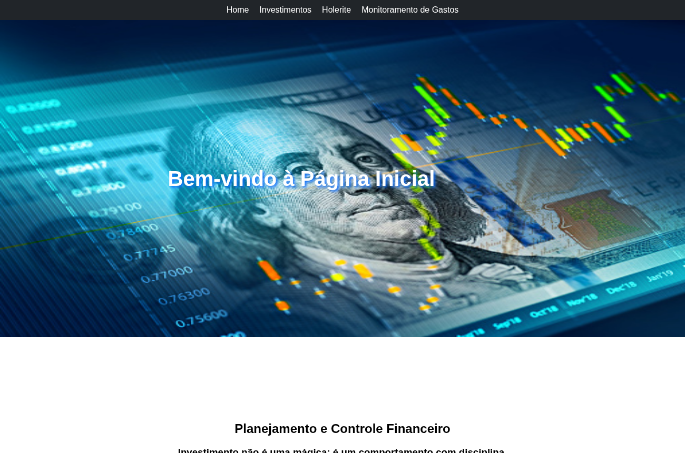

# Sistema de Gestão Financeira em Python


## Visão geral

Projeto acadêmico em equipe que reúne um **simulador de investimentos**, telas de gestão financeira e ferramentas didáticas para emissão de holerites. O objetivo é explorar desenvolvimento de interfaces web com Python, integração de fontes externas de dados e visualização interativa de indicadores financeiros.

**Desenvolvido em equipe por Amanda Guimarães, Clarice Antezana e Mateus Mussi**, conforme os créditos encontrados no material do projeto. O compartilhamento do código e a escolha de uma licença devem respeitar a autorização dos coautores.

## Status de publicação

> **Código-fonte e recursos visuais publicados:** os arquivos `app.py`, `bd.py`, `templates/`, `static/css/`, as cinco imagens da interface e uma captura demonstrativa estão disponíveis no repositório. A sintaxe dos dois arquivos Python foi verificada, mas **a execução completa não foi validada**. Um script permite gerar localmente a planilha fictícia, sem dados pessoais. Verifique as autorizações de uso das imagens e dos demais recursos compartilhados.

## Funcionalidades previstas no projeto

| Módulo | Rota | Descrição |
|---|---|---|
| Página inicial | `/` | Apresentação e navegação entre funcionalidades |
| Simulador de investimentos | `/dash/` | Simulação e gráficos de aplicações com informações financeiras externas |
| Holerite | `/holerite` | Formulário e planilha ilustrativa |
| Gastos | `/gastos` | Cadastro e organização de receitas e despesas |
| Monitoramento | `/monitoramento` | Visão resumida dos dados financeiros |

## Tecnologias

- **Python e Flask:** servidor web e rotas;
- **Dash, Plotly e Dash Bootstrap Components:** gráficos e interface interativa;
- **Pandas:** processamento de séries e dados;
- **python-bcb:** consulta de indicadores do Banco Central;
- **yfinance:** consulta de informações de mercado;
- **openpyxl:** planilhas Excel;
- **HTML e CSS:** interface das páginas.

## Instalação e execução

**Pré-requisitos:** Python 3.11+, pip e conexão com a internet para as consultas às fontes externas.

```bash
git clone https://github.com/mateus-mussi/simulador-financeiro-python.git
cd simulador-financeiro-python
python -m venv .venv
```

Ative o ambiente no Windows (PowerShell):

```powershell
.venv\Scripts\Activate.ps1
```

Ou no Linux/macOS:

```bash
source .venv/bin/activate
```

Instale as dependências, gere o **modelo fictício de holerite** e inicie a aplicação:

```bash
python -m pip install -r requirements.txt
python scripts/criar_holerite_modelo.py
python app.py
```

O gerador cria `holerite_modelo.xlsx` na raiz caso ainda não exista; **não substitui planilhas existentes**. Não use dados trabalhistas reais na versão de demonstração.

Abra `http://127.0.0.1:5000` e acesse o painel de investimentos em `http://127.0.0.1:5000/dash/`.

> **Status do desenvolvimento:** o projeto foi revisado parcialmente, mas ainda não passou por teste integral de execução. A aplicação das séries diárias SELIC/CDI e o ajuste composto por IPCA foram revisados e testados com dados sintéticos. Entretanto, a integração com APIs, os cenários reais e os resultados financeiros ainda exigem validação antes de qualquer uso para decisões de investimento.

## Testes locais

É possível executar três testes do módulo de receitas e despesas **sem consultar APIs externas**:

```bash
python -m unittest discover -s tests -v
```

Os três testes de receitas/despesas passaram na revisão local. Também foram verificados a sintaxe dos arquivos Python, a estrutura do modelo fictício de holerite e as referências de arquivos estáticos dos templates. Também foram adicionados testes com dados sintéticos para validar a **independência do valor investido em relação à visualização**, a **capitalização das taxas diárias**, os **aportes mensais** e a **composição do IPCA**. O total de 10 testes automatizados locais (3 de despesas, 1 de aportes e 6 financeiros) passou após a correção.

**Limitações restantes:** não foi possível instalar as dependências Flask/Dash, `python-bcb` e `yfinance` neste ambiente para executar a aplicação completa. As rotas web, o consumo de APIs e a exatidão das taxas/periodicidade dos cálculos permanecem sem validação integral.

### Premissas da simulação

- Aportes são realizados nos aniversários mensais da data inicial, após a aplicação da taxa daquele dia.
- A frequência do gráfico (diária/mensal/anual) modifica a visualização, não a quantidade de aportes.
- SELIC/CDI são tratados como séries percentuais diárias do Banco Central. A modalidade “Médio (CDB)” é **hipotética**, com multiplicador de 120% do CDI, sem considerar impostos, taxas ou regras de produtos reais.
- A modalidade Bitcoin utiliza variações das cotações históricas e não inclui custos de negociação.
- O IPCA é composto a partir das observações mensais disponibilizadas. O saldo final deflacionado é uma aproximação, **não um cálculo de taxa interna de retorno real**.
- Os dados sintéticos testam a lógica, mas não substituem validação das APIs e dos resultados reais.

## Validação automatizada no GitHub Actions

O repositório inclui a rotina [Testes do Simulador Financeiro](.github/workflows/testes.yml), executada em Python 3.11 a cada publicação no ramo `main` e a cada pull request. A rotina instala as dependências, cria uma planilha didática e executa:

```bash
python -m unittest discover -s tests -v
```

Os testes de fumaça em `tests/test_web.py` verificam as rotas principais do Flask e do Dash, os arquivos estáticos, o formulário de despesas, o download de holerite fictício e uma execução do callback financeiro com uma fonte SGS simulada. **O sucesso do workflow deve ser conferido na aba Actions; somente a publicação dos testes não garante que tenham passado.** Os testes não consultam as APIs financeiras reais.

## Demonstração visual

**Prévia visual da página inicial (captura demonstrativa):**



Os arquivos gráficos originais utilizados pela interface foram publicados em `static/images/`. A captura apresentada é demonstrativa e **não comprova o funcionamento do Flask, Dash ou das integrações financeiras**. Após testar a aplicação em execução, esta imagem poderá ser substituída por uma captura efetiva da interface.

## Estrutura do projeto

```text
simulador-financeiro-python/
├── app.py
├── bd.py
├── requirements.txt
├── templates/
├── static/
│   ├── css/
│   └── images/       # imagens da interface publicadas
├── scripts/
│   └── criar_holerite_modelo.py
├── tests/
│   └── test_bd.py
├── docs/
├── .gitignore
└── README.md
```

## Limitações conhecidas

- O módulo de gastos é um protótipo sem armazenamento persistente;
- A geração de holerites é ilustrativa e não tem validade trabalhista;
- Corrigida a contagem de aportes: o total investido não depende mais da frequência de exibição do gráfico (mensal/anual) no caso sintético testado;
- SELIC/CDI agora são aplicados como taxas diárias nas datas registradas, e o capital final ajustado pelo IPCA usa a composição das taxas mensais disponíveis. A validação com séries reais e o impacto dos períodos parciais ainda são pendentes;
- O valor apresentado como **capital final ajustado pelo IPCA** não equivale ao lucro real de uma carteira com aportes periódicos; isso exigiria deflacionar separadamente cada fluxo de caixa;
- Os retornos de Bitcoin, os dados externos e o comportamento completo do painel **ainda exigem testes**;
- O código não deve receber dados pessoais ou financeiros reais sem medidas adicionais de segurança;
- Imagens pessoais, planilhas reais e credenciais não devem ser publicadas.

## Autoria e licença

O projeto é acadêmico e foi desenvolvido em grupo. **Nenhuma licença aberta foi aplicada automaticamente.** A inclusão do arquivo `LICENSE` depende da concordância dos coautores e da revisão de direitos sobre recursos externos.
